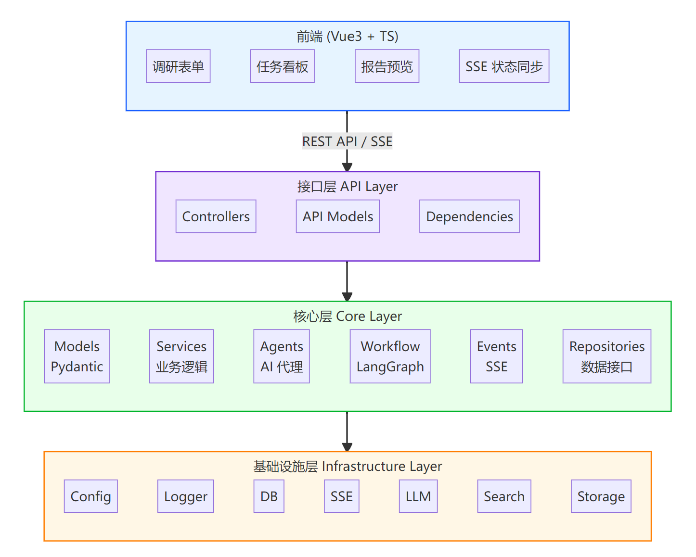
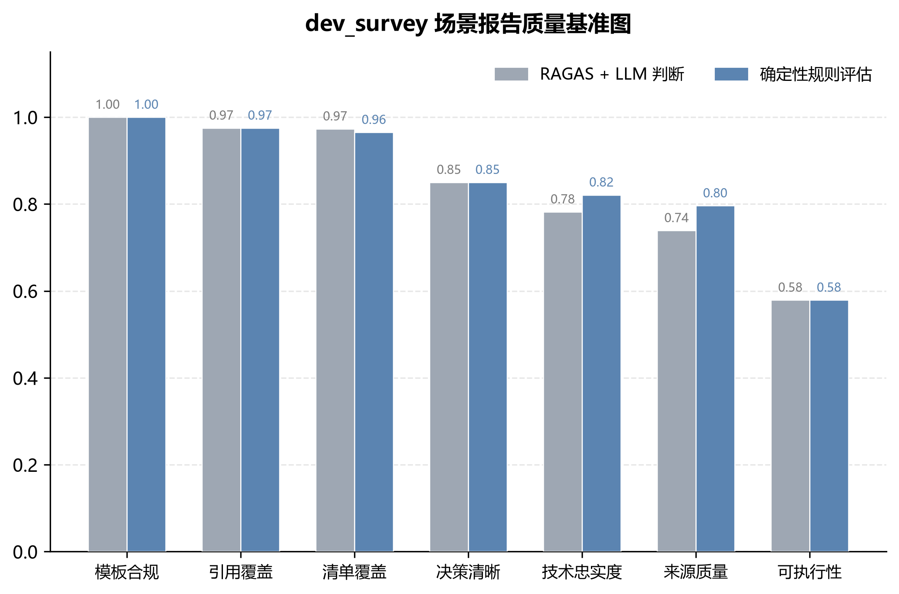

# DeepResearch

**带评估闭环的多智能体深度调研系统** · *A multi-agent deep research system with a built-in evaluation loop.*

---

DeepResearch 是一个 AI 驱动的调研系统：输入一个调研主题，多 Agent 自动完成
**规划 → 搜索 → 总结 → 生成报告**，通过 SSE 实时推送进度，并在报告生成后
**自动执行 5 维质量评估**。

核心设计是 **Harness 通用能力层与 App 场景自治层分离**——LLM 调用管理、评估框架、
检索源路由、可观测、存储抽象沉淀在可复用的 harness 底座上；调研只是挂在上面的一类
场景，新场景 3 步接入、不改核心。

**技术栈**：FastAPI · LangGraph · Vue3+TS · PostgreSQL · RAGAS · LangSmith · MinIO · Qwen · Tavily

## 🏗️ 架构

上层是场景，下层是可复用的 harness 底座：接口层 → 核心层→ 基础设施层。

<p align="center">

</p>

## ✨ 关键特性

**平台底座（harness 层）**

- **LLM 工厂**：6 类提供商可插拔，TTL 缓存 + 双重检查锁 + 异步连接池释放 + 可重试错误分类
- **评估框架**：可复用的多维评估（RAGAS + LLM-judge + 规则 + 编排器），异步执行并存库
- **源路由抽象**：可插拔检索源（GitHub / Stack Overflow / Tavily），按意图路由
- **可观测**：内置链路追踪（trace_context / trace_service），集成 LangSmith
- **存储抽象**：本地 / MinIO / PostgreSQL可切换

**调研能力（场景层）**

- **多 Agent 协作**：规划 / 搜索 / 总结 / 生成 四类 Agent 分工
- **并行执行**：多任务并行 + 动态并发度控制
- **场景插件化**：3 步新增场景，不改核心

## 📈 Benchmark

`dev_survey` 场景基准，覆盖**运行性能**与**报告质量**（N=63 工作流 / 28 份报告，2026-08 采集）。

### 运行性能

| 指标 | 结果 |
|---|---|
| 并行执行（N=8，并发 K=3） | 加速 **2.7x**（K=5 时 4.0x） |
| LLM 调用最终成功率（注入 15% 429 故障） | **84.7% → 99.2%** |
| 注入故障下报告完整产出率 | **30.0% → 95.0%** |
| 工作流耗时 P50 / P95（生产，参考值） | ~4.4 / ~9.7 min |

### 报告质量

同一批 28 份历史报告，用两种方法分别评分：**确定性规则评估**与 **RAGAS + LLM 判断**，两者结果一致。
<p align="center">

</p>

整体达标率 **85.7%**（24/28）。

## 📦 内置场景

| 场景 | 说明 |
|---|---|
| `dev_survey` | 面向开发者的技术方案调研：技术栈对比选型、架构设计、陷阱与最佳实践（含 critic 反思 + 3 个领域评估器） |
| `research_assistant` | 通用多智能体调研：任意主题的规划-搜索-总结-报告 |

## 📊 评估指标

报告生成后异步评估，结果存库，指标集按场景配置，下表为 `dev_survey` 场景：

| 指标 | 含义 | 实现 |
|---|---|---|
| Technical Faithfulness | 技术准确性 | RAGAS |
| Source Quality | 信源质量 | 规则评估 |
| Checklist Coverage | 清单覆盖度 | 规则 + LLM |
| Template Compliance | 模板合规性 | 规则评估 |
| Actionability | 可执行性 | 规则评估 |
| Decision Clarity | 决策清晰度 | 规则评估 |
| Citation Coverage | 引用覆盖度 | 规则评估 |

## 🚀 快速开始

### 前置要求
- Python 3.10+ · Node.js 18+ · Docker & Docker Compose
- Qwen API Key · Tavily API Key

### 1. 环境配置
```bash
cp .env.example .env   # 填入 QWEN_API_KEY / TAVILY_API_KEY / 数据库与存储配置
```

### 2. 启动基础设施
```bash
docker-compose up -d   # PostgreSQL + MinIO
```

### 3. 后端
```bash
cd backend
python -m venv venv
source venv/bin/activate      # Windows: venv\Scripts\activate
pip install -r requirements.txt
python main.py                # http://localhost:8000 （Swagger: /docs）
```

### 4. 前端
```bash
cd frontend
npm install
npm run dev                   # http://localhost:3000
```


## License

MIT
